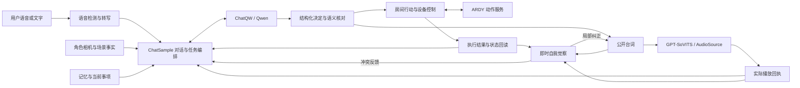

# NeEEvA

NeEEvA 是一个基于 Unity 的具身 AI 角色项目：角色在 3D 房间里听用户说话、观察环境、进行语音对话，并尝试完成靠近、跟随、寻找物件和操作场景设备等任务。项目也保留了长期记忆、录音片段回唱、VRM 表情与 PC VR 接入。

**当前说明对应 `codex/project-checkpoint-20261015` 分支，更新于 2026-10-17 14:15:37 JST（UTC+09:00）。** 本仓库是持续开发中的源码工程，不是包含全部模型、音色和房间资源的安装包。

## 与 project-checkpoint-20261011 的主要区别

本分支相较于 `codex/project-checkpoint-20261011` 的主要区别是新增了 **“即时自我觉察功能”**（Activity Monitor）。角色在说话和行动进行时，并行观察自己正在说什么、做什么，以及事实是否发生变化，据此作局部纠正；正常流程无需等待这一监控请求完成。

- **觉察说话与事实的关系：** 区分排队时、开始出声时和当前的执行事实，判断是原话有误、表达过于确定，还是说话后环境发生了变化；保留当时真实发生的过去事件。
- **按播放进度纠正：** 尚未播出的事实子句可局部替换；已经出声的内容通过后续简短台词纠正。被打断的音频不被当作整句已经播完。
- **觉察行动中的冲突：** 独立检查正在执行的行动。发现具体冲突时，只能停止已接入且版本仍匹配的可取消活动；后续意图交回正常规划，不直接执行新动作，也不撤销已完成的效果。
- **保持正常表达与行动：** 愿望、感受、邀请、提问和明确表达不确定性的推测，不因缺少事实证明而被纠正；仅仅尚未完成，也不是停止正常行动的理由。

代码默认开启 `ChatSample.m_EnableActivityMonitor`，当前由支持该接口的 `ChatQW` 提供模型判断。监控有请求频率、上下文、纠正次数和超时限制，并在应用结果前重新检查版本与事实；监控超时或失败时原流程继续运行。“即时”指过程中的反馈能力，不表示逐帧推理或零延迟。

实现入口：[ChatSample.ActivityMonitor](Assets/AIChatTookit/Scripts/Chat/ChatSample.ActivityMonitor.cs)、[ActivityMonitorProtocol](Assets/AIChatTookit/Scripts/Chat/ActivityMonitorProtocol.cs)、[ChatQW.ActivityMonitor](Assets/AIChatTookit/Scripts/LLM/QW/ChatQW.ActivityMonitor.cs)。

## 更新记录

按时间倒序排列，时区为 JST（UTC+09:00）。记录时间表示版本汇总时间，不是每项代码修改的完成时间。

### 2026-10-17 14:15:37 JST — 自我觉察、结果交付与任务连续性

本次汇总相对于即时自我觉察初版提交 `6d0b015` 的改动，继续更新同一分支。

- **自我觉察的证据核对：** 增加操作、对象、主语、时间及证据范围的绑定，避免跨任务、跨轮次或用后来的结果反驳先前话语。未知、空记录与缺少信息不能直接证明“没有发生”；视觉断言可回查生成该回复时使用的同一张图片。监控增加上下文裁剪、预算计算、失败反馈和有限重试，未完成检查不会被记成已经核验。入口：[证据策略](Assets/AIChatTookit/Scripts/Chat/ActivityEvidencePolicy.cs)、[视觉核验](Assets/AIChatTookit/Scripts/Chat/ChatSample.ActivityVisualEvidence.cs)。
- **逐项核对结果是否已播报：** 动作结果、独立问题与实际音频播放记录分别保存；根据已播原句区分接受请求、未来承诺、进行中说明和结果告知。漏报时补充，已经告知时避免重复；后续明确撤回或矛盾时重新核对。失败和受阻也能如实告知并结算，不能被改写为成功或自动触发重做。入口：[结果交付](Assets/AIChatTookit/Scripts/Chat/ChatSample.ActivityDelivery.cs)、[已播证据选择](Assets/AIChatTookit/Scripts/Chat/ResultPlaybackSelection.cs)。
- **任务停止与续接：** 监控停止动作后建立明确交接，保留父任务及未完成部分，不把本地干预当成服务故障。前置步骤失败时，相关后续步骤标记为受阻且未启动；恢复时保留已完成项，重新绑定待执行步骤。台词按步骤归属处理，独立回答不会因另一动作交接而一并丢弃。入口：[监控交接](Assets/AIChatTookit/Scripts/Chat/ChatSample.ActivityHandoff.cs)、[任务续接](Assets/AIChatTookit/Scripts/Chat/TaskContinuationContextPolicy.cs)。
- **新增历史场景回看：** 针对先前视野、物件或方向的请求，有限地回看保留画面，并对选中的物件做局部核验。区分“回看旧图可以确认”“当时已经注意到”和“现在仍然可见”；转向之后再用新画面确认，旧图不证明当前状态。入口：[场景召回](Assets/AIChatTookit/Scripts/Chat/ChatSample.SceneRecall.cs)。
- **请求分类与失败说明：** 首句理解补充问题指代、时间范围和所需证据，区分纯转向、当前视觉与历史回忆。分类失败或上下文超限时记录本轮处理失败，明确尚未由此派发新操作，保留原请求和已有行动，不借用旧成功结果。入口：[请求失败处理](Assets/AIChatTookit/Scripts/Chat/ChatSample.RequestFailure.cs)。
- **语音生命周期、语言与转写：** 开场短语结束后释放说话显示和麦克风保护；清理音频已结束却残留的“正在说话”状态。取消时保留实际播放证据并使未播队列失效。新增 TTS 语言标签核对，ASR 对比分段来源、重叠和尾部语义，避免把识别候选或语气词拼成额外指令。入口：[播放生命周期](Assets/AIChatTookit/Scripts/Chat/ChatSample.SpeechLifecycle.cs)、[语言核对](Assets/AIChatTookit/Scripts/Chat/ChatSample.SpeechLanguage.cs)。
- **动作准备阶段的有限恢复：** 姿态历史采样间隔超过 0.15 秒时，可重新采集连续窗口，最多重启两次，总时限四秒。无法恢复时明确标为本地采样不可用，且不会发送远端生成请求。入口：[采样窗口策略](Assets/AIChatTookit/Scripts/Motion/ArdyPoseHistoryWindow.cs)。
- **诊断与回归覆盖：** 扩展上下文压缩及预算检查、监控请求追踪、TTS 错误响应和麦克风/VAD 日志；新增 12 个回归测试源文件和 14 份 JSON 样本，覆盖证据、任务交接、历史视觉、复合请求播报、运行失败等情形，并扩展现有回归入口。

本条按源码差异整理；本次 README 更新与上传未重新运行 Unity 或真实模型回归。新增测试和样本不等于当前版本已经全部通过端到端验证。

### 2026-10-15 14:24:05 JST — 即时自我觉察初版

提交 `6d0b015` 创建本分支，主要区别为上文所述的“即时自我觉察功能”：在说话和行动进行时并行监控，按播放状态局部纠正，并将行动冲突交回正常规划。此处时间取该提交的记录时间。

## 当前能力

| 模块 | 当前实现与边界 |
| --- | --- |
| 实时对话 | 麦克风检测、SenseVoice 增量转写与完整语音校正、流式文本、GPT-SoVITS 流式语音及用户打断。临时理解、内部审核与公开台词分开处理。 |
| 角色视觉与注意力 | 从角色视角采集房间画面，结合可见物件、空间记忆与当前任务进行观察、搜索、转向及观察位置调整；支持有限的历史画面回看和当前视野再确认。桌面画面可显示在房间电视上，历史观察不等于当前可见事实。 |
| 房间行动 | ARDY 对话动作与连续移动、靠近用户或物件、跟随、停止及任务交接；包含路径检查、流式动作延迟处理和恢复逻辑。动态动作质量仍需场景实测。 |
| 多步骤任务 | 解析完整请求中的动作、条件、撤回与顺序；维护步骤依赖，在实际完成后续接。设备任务覆盖寻找、靠近、操作及状态核验，只作用于已接入的场景对象。 |
| 行为与说话核对 | 公开表达与目标身份、实际执行状态和播放回执关联。生成了文字、动作已提交、动作已完成、用户已听到结果分别记录；逐项核对结果和独立问题的实际播报，必要时补充。失败结果也可以完成告知，不会因此被改记为成功。 |
| 即时自我觉察（本分支新增） | 在说话与行动进行中并行监控事实变化，按播放进度局部纠正台词，并对具体行动冲突反馈停止或重新考虑。 |
| 自主行为与记忆 | 根据当前事项、观察、用户约束及工具结果安排后续检查、回应或等待；提供记忆图谱与可选的语义召回。自主续接有预算和失效检查。 |
| 歌唱 | 管理真实录音片段与本地曲库，按具体素材、范围和顺序回唱；可接入歌声合成与音色转换。不能仅凭歌名生成从未获取的完整原曲，当前也不是严格同步合唱。 |
| 形象与交互 | VRM 角色、口型、眨眼、Artifairy 形态键同步和弹簧骨骼；桌面自由视角及 OpenXR/PICO 相关接入。完整 Android 体验需要另外部署和验证。 |

这些是当前代码提供的能力与约束，不代表所有模型、房间、设备和自然语言组合都已通过验收。当前开发主线使用 `ChatQW`；其他 LLM 接入和 Qwen-Omni 示例仍在仓库中，但不保证具有同等的视觉、任务和动作能力。

## 系统如何连接



Qwen 负责理解、选择和表达，Unity 持有场景对象、任务状态、可执行接口与播放状态。决定通过检查后才提交执行；旧用户轮次、旧目标或已取消任务的异步回调不能直接继续操作。

完整动作链路还使用共享 Qwen 服务的专用动作特征接口，再由适配器连接 ARDY。普通聊天 API 可用，并不意味着动作特征接口也已部署。

## 运行准备

### 环境与仓库范围

- **Unity 2022.3.22f1**，版本以 [ProjectVersion.txt](ProjectSettings/ProjectVersion.txt) 为准。
- 现有服务管理脚本主要面向 **Windows + PowerShell**。本地 GPU 服务需要与各自推理环境匹配的 CUDA/PyTorch；当前开发部署把 Qwen/嵌入服务与 Unity/语音/ARDY 分在两台机器上运行。
- SenseVoice 使用 Python 环境；ARDY 安装流程要求 Python 3.11+、可用的 CUDA PyTorch 和对应资源。不同服务的依赖应按各自说明安装。
- Unity 包版本由 [Packages/manifest.json](Packages/manifest.json) 管理；UniVRM/UniGLTF 源码位于 `Assets/`。首次打开需等待依赖安装及资源导入。

仓库包含 Unity 代码、已跟踪的场景和角色资源、服务桥接代码、启动脚本及回归用例。以下内容需要另行准备：

| 资源 | 位置或说明 |
| --- | --- |
| Qwen、视觉投影与嵌入模型 | 本地 llama.cpp 目录或远端推理机；不随此仓库提供。 |
| GPT-SoVITS 服务、权重与音色配置 | 项目根目录 `GPT-SoVITS/`；仓库仅保留其中的启动脚本。参考音频路径须与自己的部署一致。 |
| ARDY 上游代码、环境、模型、适配器与运行证据 | `Server/ARDY/` 和 `Tools/MotionAdapter/` 下的忽略目录，以及本机模型缓存。 |
| 歌声合成、转换模型与用户曲库 | 各 `Server/` 子目录中的模型、运行环境和录音数据；按需部署。 |
| 私有房间与衍生场景依赖 | `Assets/Private/`、`LocalPrivate/` 中的本机资源。即使仓库保留了某个场景文件，也不代表其引用的素材齐全。 |

完整排除规则见 [.gitignore](.gitignore)。克隆仓库不能还原开发机上的全部私有场景、语音模型和运行数据。

### 先打开 Unity 工程

```powershell
git clone --branch codex/project-checkpoint-20261015 https://github.com/Enishiya770/NeEEvA.git
cd NeEEvA
```

已有工程直接使用自己的工作目录，无需重新克隆。

1. 用 Unity Hub 按上述版本打开工程。
2. 从 `Assets/AIChatTookit/Scene/chatSample.unity` 开始检查基础对话；白盒房间位于 `Assets/Scenes/NeEEvARoom.unity`。私有房间及 Artifairy 衍生聊天场景需额外资源。
3. 在 `ChatSample` 的 Chat Settings 中检查模型、语音组件及对象引用；涉及房间行为时，同时检查 `ArdyRoomDialogueBridge` 的角色、环境和用户位置绑定。
4. 配置下面的模型与语音服务后再进入 Play Mode。当前 Build Settings 的场景列表为空；制作构建时需手动加入目标场景。

### 配置模型与语音

`ChatQW` 提供两种后端。仓库中的 `chatSample.unity` 当前配置为 Local，地址为 `http://127.0.0.1:8080/v1/chat/completions`。

| 配置 | Local | Cloud |
| --- | --- | --- |
| `m_Backend` | `Local` | `Cloud` |
| 服务地址 | `m_LocalUrl` | 代码使用 DashScope 兼容接口 |
| 模型名称 | `m_LocalModelName`，与自己的服务配置匹配 | `m_ChatModelName`，使用账号实际可用的模型 |
| 密钥 | 根据所部署服务的认证要求配置 | 在 `api_key` 中填写自己的密钥 |
| 角色视觉 | 需要支持图片输入的模型及视觉投影 | 需要所选模型支持图片输入 |

完整房间行为不能只靠替换模型名称获得。当前本地链路使用 llama.cpp 相关扩展；替换成其他兼容服务时，需分别验证结构化输出、视觉、并发和动作特征协议。

**SenseVoice：** 在已准备并激活的 Python 环境中，从项目根目录执行：

```powershell
python -m pip install -r Server/SenseVoice/requirements.txt
Push-Location Server/SenseVoice
python sensevoice_server.py
# 无 CUDA 时，可改用：python sensevoice_server.py --device cpu
Pop-Location
```

首次运行需要下载模型。服务提供最终 `/asr` 与增量 `/stream/asr`，默认监听 `127.0.0.1:9881`。上述命令在前台运行，退出服务后才返回目录。

**GPT-SoVITS：** 先部署完整运行目录、音色权重及 `GPT_SoVITS/configs/tts_infer.yaml`，再检查 Unity `GPTSoVITSFASTAPI` 的参考音频、参考文本和语言配置。启动入口是 `GPT-SoVITS/start_tts_server.bat`。当前流式模式需要项目适配，详见 [GPT-SoVITS 补丁说明](Server/GPT-SoVITS-patch/README.md)；只复制启动脚本无法获得语音服务。

**ARDY：** 房间动态动作需要 Qwen 动作特征接口、匹配的适配器及 ARDY 环境。部署入口见 [MotionAdapter](Tools/MotionAdapter/README.md)、[共享 Qwen 特征接口](Tools/MotionAdapter/native/README.md) 和 [ARDY 服务说明](Server/ARDY/motion_service/README.md)。环境就绪后，可从项目根目录运行：

```powershell
.\Server\ARDY\start_motion_service.ps1
```

## 启动入口与服务地址

### 已配置好的开发环境

当前 `start_all.cmd` 的实际顺序是：**远端共享 Qwen 动作特征模式与嵌入服务 → 本地 ARDY → 本地语音与歌唱服务**。它使用 SSH 别名 `neeeva-5090` 及远端已有控制脚本；不是适用于任意新机器的一键安装器。

| 入口 | 实际用途 |
| --- | --- |
| `start_all.cmd` | 启动完整开发服务栈，包含动作特征与 ARDY。 |
| `start_chat.cmd` | 远端 LLM/嵌入 + 本地 TTS/ASR；不启动 ARDY 或歌唱服务。 |
| `start_llm.cmd` / `start_remote_llm.cmd` | 远端 LLM/嵌入及 SSH 转发，使用默认聊天模式。 |
| `start_cloud.cmd` | 为 Cloud 后端启动本地嵌入、TTS、ASR、VC、SVS；不启动 ARDY。 |
| `start_local_llm.cmd` | 停止远端服务栈后启动本地 LLM。 |
| `start_local_all.cmd` | 停止远端服务栈后启动本地六项服务；不等同于含 ARDY 的完整动作栈。 |
| `status.cmd` | 检查 ARDY、本地语音、远端服务及隧道状态。 |
| `stop_all.cmd` | 依次停止受管理的 ARDY、本地语音、远端隧道和模型服务。 |

远端配置背景见 [远端 LLM 部署记录](docs/remote-llm-5090.md)。该文包含历史部署信息，启动行为以根目录脚本为准。已有聊天模式 Qwen 时，完整动作启动不会悄悄替换它；应在会话结束后停止相关服务，再选择完整入口。

### 在自己的机器上按需启动

先准备各服务环境和模型，再使用对应服务脚本。只需要已部署好的 TTS/ASR 时，可在项目根目录执行：

```powershell
.\Tools\neeeva_services.ps1 start -Only tts,asr
.\Tools\neeeva_services.ps1 status -Only tts,asr
```

本地服务控制器可用 `NEEEVA_LLAMACPP_ROOT` 指定 llama.cpp 目录，默认路径为开发机的 `E:\llamacpp`；脚本中的模型文件名也需与实际资源匹配。单机运行的状态和停止操作使用该控制器对应的 `status` / `stop`，不要把依赖远端 SSH 的根目录入口当成通用管理器。

| 服务 | 默认本地端口 | 用途 |
| --- | --- | --- |
| Qwen | `8080` | 聊天、视觉；完整模式额外提供动作特征。远端部署通过 SSH 映射到本地。 |
| 嵌入服务 | `8090` | 可选的记忆语义召回。 |
| ARDY | `8093` | 对话动作与房间移动。 |
| GPT-SoVITS | `9880` | 对话语音合成。 |
| SenseVoice | `9881` | 语音识别与录音分析。 |
| Seed-VC / RVC | `9882` | 歌声音色转换。 |
| SVS | `9883` | 独立歌声合成及后端路由。 |

端口可在组件或启动配置中调整。跨机器使用时，`127.0.0.1` 永远指向当前运行客户端的机器；头显独立运行时也一样。

## 使用与扩展

- **先验证对话，再启用房间动作。** 检查文本返回、实际出声和麦克风输入，再验证角色看到的画面、对象绑定及行动结果。屏幕上出现台词不等于音频已播放完毕。
- **检查角色视野。** 运行中的 `Tools → NeEEvA → Character Scene Vision` 可查看采集图像和观察身份；角色视角、玩家相机和桌面截屏是不同来源。详见 [角色场景视觉](docs/scene-vision-20260913.md)。
- **场景设备需要接入。** “打开电视”等请求针对已接入的 Unity 设备及其可用控制，不提供对任意现实设备的通用控制。设备状态要由实际执行和回读确认。
- **切换角色。** `Assets/Model/` 包含已有角色资源及 Artifairy 变体；需重新核对 VRM、口型、表情、动作参考姿态和场景绑定，拖入模型不等于完整聊天场景配置完成。
- **桌面与 VR。** 桌面自由视角使用右键配合 WASD、Q/E；具体相机和 OpenXR 配置见 [玩家相机与 PICO VR](docs/player-camera-vr.md)。该文的历史测试记录不能代替当前设备的构建和实机验证。
- **歌唱按需部署。** 当前素材协议以真实 `clip` / `song` 引用为基础，见 [歌唱素材协议](docs/singing-material-protocol.md) 与 [运行提示词](Assets/AIChatTookit/Prompts/Skills/singing.txt)。后端安装分别见 [SVS](Server/SVS/README.md)、[DiffSinger](Server/DiffSinger/README.md)、[Seed-VC](Server/SeedVC/README.md)、[RVC](Server/RVC/README.md)。合成与音色转换是不同环节，模型缺失、语种和音质限制需分别检查。

## 开发与验证

### 代码导航

| 路径 | 内容 |
| --- | --- |
| `Assets/AIChatTookit/Scripts/Chat/` | `ChatSample` 对话编排、任务续接、观察与播放回执；`ArdyRoomDialogueBridge` 连接房间执行；各类协议检查。 |
| `Assets/AIChatTookit/Scripts/LLM/QW/` | Qwen 请求、首句、房间决定、上下文、事实与语义审核、流式恢复。 |
| `Assets/AIChatTookit/Scripts/Perception/` | 角色视觉、观察对象、候选与可见目录。 |
| `Assets/AIChatTookit/Scripts/Motion/` | ARDY 播放、导航、连续移动、交接与恢复。 |
| `Assets/AIChatTookit/Scripts/TTS&&STT/` | 语音识别与合成接入。 |
| `Assets/AIChatTookit/Scripts/Memory/` | 记忆图谱、持久化与召回。 |
| `Assets/AIChatTookit/Scripts/Expression/` | 口型、眨眼与形态键同步。 |
| `Assets/AIChatTookit/Scripts/Presentation/` | 界面、玩家相机与 XR 交互。 |
| `Assets/AIChatTookit/Prompts/` | 角色与行为提示词、按领域加载的提示规则。 |
| `Assets/Editor/`、`Assets/Editor/Fixtures/` | Unity 回归入口、编辑器工具与重放样本。 |
| `Server/` | ASR、TTS 补丁、歌唱桥接及 ARDY 服务。 |
| `Tools/MotionAdapter/` | 动作特征、适配器、验证脚本和历史报告。 |
| `docs/` | 专题说明与带日期的设计、实验和交付记录。 |

当前任务编排可从 [RoomTaskSequenceProtocol](Assets/AIChatTookit/Scripts/Chat/RoomTaskSequenceProtocol.cs)、[RoomTaskContextPolicy](Assets/AIChatTookit/Scripts/Chat/RoomTaskContextPolicy.cs) 阅读；表达与执行事实关联见 [RoomSpeechClaimProtocol](Assets/AIChatTookit/Scripts/Chat/RoomSpeechClaimProtocol.cs)，结果告知结算见 [WorkResultDeliveryProtocol](Assets/AIChatTookit/Scripts/Chat/WorkResultDeliveryProtocol.cs)。

### 验证入口与证据范围

- Unity 用例位于 `Assets/Editor/*Regression*.cs`。不同用例有纯协议、模拟传输、真实模型请求和 Play Mode 检查，依赖与运行方式并不相同。
- [传输与房间回归脚本](Tools/MotionAdapter/run_transport_recovery_regressions.ps1) 使用已有的 `Server/ARDY/runtime/unity-naturalness-validation` 隔离工程，并要求新的输出目录；部分模式还需要图形、服务或指定输入。它会复制当前源码及 fixtures 到隔离工程，Unity 可执行文件路径也仍按开发机设置。换机器需先适配环境，不能在刚克隆的仓库直接当作通用测试命令运行。
- ARDY 服务测试入口见 [服务 README](Server/ARDY/motion_service/README.md)。例如，在依赖就绪的 ARDY 环境中可运行不调用真实模型的截止时间回归：

  ```powershell
  .\Server\ARDY\.venv\Scripts\python.exe -m unittest Server.ARDY.test_stream_deadline_diagnostics -v
  ```

- 带日期的 JSON fixture、历史报告和通过数量仅说明当时的输入与环境；不能据此断言当前提交全部通过。自然动作、语音音质、长对话和实体 VR 仍需实际体验验证。

### 常见问题

| 现象 | 优先检查 |
| --- | --- |
| `start_all.cmd` 无法连接远端 | 是否配置 SSH 别名、远端控制脚本与模型；新机器应先按需部署服务。 |
| 文字正常但不出声 | TTS 端口、参考音频路径、语言设置、实际播放状态，以及 GPT-SoVITS 补丁；HTTP 422 不代表 WAV 本身损坏。 |
| 能聊天却不能移动 | ARDY `8093`、Qwen 动作特征模式、适配器资源，以及角色/环境/用户位置绑定。 |
| 角色描述的画面不对 | 角色视觉预览、采集时刻、眼位、朝向、遮挡；旧物件记忆不能代替新观察。 |
| 克隆后房间或模型引用缺失 | 场景引用是否指向私有资源或未下载的模型，避免把开发机本地文件视为仓库内容。 |

服务管理日志位于 `Server/RuntimeLogs/`；Unity 运行错误先查看 Console 和 Editor 日志。语义审核也由模型执行，结构检查和状态回执可以约束执行，但不能消除全部自然语言理解错误。

## 第三方与资源许可

项目基于 AIChatToolkit 扩展，使用 UniVRM/UniGLTF、OVRLipSync、SenseVoice/FunASR、GPT-SoVITS，以及 Qwen、ARDY 等模型与运行组件；可选歌唱链路使用 SoulX-Singer、DiffSinger、Seed-VC、RVC、torchcrepe 和 MusicBrainz 等项目或服务。

本仓库未附带覆盖整个项目的统一开源许可证。第三方源码、模型、音色、角色和场景素材分别受原作者许可约束；仓库中存在文件不等于授予其再分发或商用权。私有 SailingMoon 房间素材保持本地使用，具体排除范围见 `.gitignore`。

API 密钥、用户录音、个人曲库及运行数据应保留在本地配置或约定的忽略目录中。保存、提交场景和配置前，应检查是否包含个人凭据或不应上传的资源。
