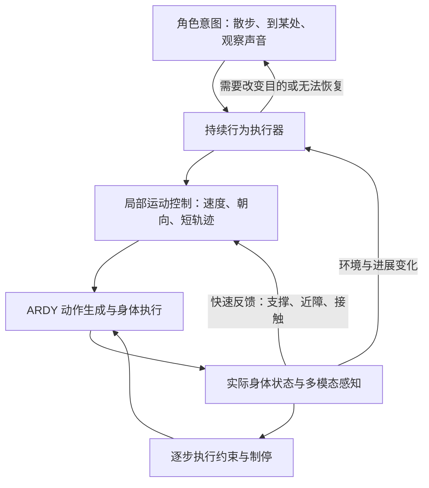

# 持续行动与感知反馈：讨论稿

日期：2026-09-23。状态：依据最新主 Unity 日志和现有代码的架构建议，本轮未修改运行逻辑，也未启动新的动作测试。

## 最新房间会话的事实

来源为本机 `C:/Users/33830/AppData/Local/Unity/Editor/Editor.log`；只读快照与解析保存在 `work/embodied-action-design-20260923/`。下表将日志 UTC 转为本地 Asia/Tokyo。

| 本地时间 | 事实 |
| --- | --- |
| 10:29:34 | `explore` 被受理，父目标建立 |
| 10:29:45 | 第一次自主 `move-to-ground` 在像素定位阶段被拒绝 |
| 10:30:00 | 第二次同样被拒绝 |
| 10:30:15 | 第三次同样被拒绝，父目标随后进入 blocked，禁止旧自主意图重新启动 |

三次理由均为“该像素落在透明、动态或未验证材质上，本批无法可靠定位。”三次根位置一致，arrivals=0，没有提交对应移动给 ARDY。日志末尾的禁用、销毁、断开记录不应作为这三次运行期失败的根因。

`SceneVisionGrounding.TryResolve` 在深度/对象 ID 图的 id<0 时给出上述综合理由。日志没有保留该像素对应的 renderer、材质和 shader，不能据此认定房间地板透明，也不能直接认定某一种 shader 就是根因。三次 label 都是“房间地板空地”；早期拒绝 fact 中的 requestedImagePoint=(0,0) 是未赋值的默认字段，不能据此还原模型选点。

这次故障揭示了当前入口的限制：身体起步依赖一次成功的视觉像素定位；局部定位拒绝又会累计为整个探索任务失败。平地测试证明过视觉选点至 ARDY 执行能连通，没有证明完整房间的自由行动已经成立。

## 需要调整的行动定义

视觉定位是“走到指定可见位置”的有效能力，应保留。它不应成为所有移动唯一的起步条件。

散步可以没有固定终点，但需要持续的活动意图、当前身体状态、近期可行方向和停止条件。例如“在当前房间慢慢走走，允许停下来观察”。行为可以先选择一个短期方向，在执行中观察、调整速度、转向、等待或改换活动。不能把每个近期轨迹末端解释成最终到达并强制结束动作。

建议区分三个身份：

- 目标：为什么还在行动，如探索房间；可跨多个行为存在。
- 行为：正在采用什么持续策略，如散步、有目标导航、跟随、观察声音来源。
- 控制片段：接下来一小段身体控制，如期望速度、朝向、短轨迹或某只手的接近运动。

控制片段结束、局部阻挡和父目标结束是不同事件。发言轮次的 generation 不应继续兼任身体行为的身份。

## 两条反馈回路



LLM 负责活动选择、解释重要变化和修改意图；局部控制负责持续速度、方向、近障处理；执行约束在每次实际施加运动前检查并可立即拒绝本帧位移。这些层次不意味着每层都调用一次大模型。

首版可沿用现有跟随的本地更新节奏做起点，再按实测成本调节。物理反射按执行/物理步检查，局部控制先以约 5–10 Hz 为测量起点，语义模型按重要事件和较低频率复查。这些是设计/调优起点，不是已经测得的延迟承诺。项目 Fixed Timestep 配置为 0.02 秒，但现有 ARDY 应用守卫在其播放帧中执行，不能把二者混称为已经实现的 50 Hz 接触控制器。

独立于慢规划的即时制停有现成工程参考：Nav2 Collision Monitor 使用传感输入限制或停止速度命令，不要求先等规划器重新产出路径。[Nav2 官方文档](https://docs.nav2.org/rolling/configuration_and_development/configuration_guide/core_servers/collision_monitor/configuring_collision_monitor_node/)。这里借鉴职责划分，不建议为此把 Unity 工程迁移到 ROS。

## 感知各自提供什么

| 感知来源 | 可用于行动的事实 | 限制 |
| --- | --- | --- |
| 视觉语义 | 物体、兴趣点、房间结构的解释 | 有推理延迟和不确定性，不能独自承担逐帧制停 |
| 局部深度/近场几何 | 当前可通行方向、距离、支撑缺失 | 虚拟传感器需定义范围、时效和遮挡；全场景信息不自动等于角色看见 |
| 本体状态 | 实际姿态、位置变化、速度、支撑状态、运动是否受阻 | 以已执行状态为真值，不能把生成轨迹当实际发生 |
| 空间听觉 | 声音方向、强度/显著性、时间和不确定性 | 目前语音转写不等于声源方向；场景声音和真实麦克风来源需要各自实现 |
| 实际接触 | 身体部位、接触法线、相对速度/阻力、接触持续时间 | 需真实接触检测/约束；预碰撞拒绝不应伪装成已经碰到 |

Unity 物理查询可用来实现虚拟近场和接触传感，但应输出角色可感知的局部事实。不能把远处未观测物体的名称、位置和语义直接交给角色当作所见。引擎底线校验与角色认知证据应分开。

## 散步如何运行

1. 角色选择“慢速散步”，保持活动范围、偏好和可中断条件，终点为空。
2. 行为根据当前可用感知和近期访问记录形成短期方向。方向具有连续性，避免每帧随机换向；可在几个相近可行方向间按好奇、空间余量和重复程度选择。
3. 局部控制从实际身体及已承诺的未来姿态生成短轨迹，持续刷新。轨迹始终要有有效支撑与身体净距；无固定终点不等于允许盲走。
4. 感知到前方拥挤时降低速度，有人临时经过时停稳等待，发现可通行侧向空间时修改短轨迹。动态阻挡需要局部重新规划，不能仅把旧路径重放。
5. 若发生意外接触，执行层先中止受影响方向并报告实际接触，行为再选择后退、侧移、观察或等待。回退与侧移也必须验证，不能自动假设身后可走。
6. 出现新的兴趣点、声音或用户指令时，行为可调整关注对象；达到结束条件或明确被取消时释放身体资源。

“被挡住”是可恢复事件；“必要能力不存在”“持续无可行控制”“执行后端不可用”才按相应策略升级。重复等待需要恢复条件、迟滞、超时和有限的无进展预算，避免每帧反复撞同一处。

## 可以复用的现有能力

- `ArdyRoomLocomotionController.Stream.cs` 的 `BeginContinuousFollow` / `TryUpdateContinuousFollow` 已能在同一执行会话内改变路线、速度及控制 revision。
- `ArdyLocomotionPlayer.Stream.cs` 的 `ReplaceStreamingTail` 保留世界锚点、身体所有权和已确认历史，仅接入未来新样本。
- native 流式路径通常生成 40 帧预测，20 fps 下为 2 秒，确认其中 8 帧即 0.4 秒。当前启动缓冲为 0.8–1.2 秒；0.4 秒不等于从感知到改变动作的总延迟，必须测量请求、排队、生成、缓冲和实际应用。
- `ArdyLocomotionPlayer.cs` 在写入根节点和骨骼前执行 guard；`ArdyRoomNavigation.cs` 已有支撑、overlap 和身体胶囊 sweep。
- 当前 `TryHandleLiveGuardStop` 会结束该次执行为 Fail。跟随有部分保留任务后恢复的逻辑，可提升为通用行为反馈；现状不能称为完整的局部自主绕障。

需要把 follow 特有的 userMoving/userVelocity 从通用运动执行器上移到跟随策略，使散步、跟随和到点导航都能生成同一类短时运动控制。保留单一身体写入者，不能另加一个 MoveTowards/NavMeshAgent 独立拖动角色，否则会与 ARDY 时间轴、足部和实际历史冲突。

真实接触还需建设。当前模型脚接触值是模型预测，现有几何守卫是预检查；二者都不等于全身触觉或物理抓取。Unity 的 CharacterController.Move 可以提供碰撞约束及碰撞方向，但是否用它作为适配器要与 ARDY 姿态/根运动所有权一起设计，不能直接叠加成第二个写入者。[Unity 2022.3 官方文档](https://docs.unity3d.com/2022.3/Documentation/ScriptReference/CharacterController.Move.html)。若执行被限制或停止，后续生成要从实际保留的姿态与速度恢复，不能沿用未发生的预测。

## 最小通用契约

```text
Goal: id, revision, purpose, constraints, completionPolicy
Behavior: id, goalId, kind, optionalTarget, parameters
Lifecycle: Start / Update / Suspend / Resume / Cancel
Feedback: observedAt, source, confidence, actualEffect, blocker, recoveryCondition
State: Running / Waiting / Recovering / Completed / Failed / Cancelled
ControlLease: ownerId, revision, bodyResources
```

各行为共享生命周期、感知事件、结果与资源所有权，不强求所有行为使用同一种底层控制量。行走输出速度/朝向/短轨迹；看向声音输出头身定向；伸手输出末端目标、接近速度与接触条件。伸手、坐下、抓取仍需分别落实可达性、身体约束和执行结果验证，不能由通用接口的存在推导为已实现。

## 建议的实施次序与验收

1. 补齐当前拒绝的可诊断性：原始像素、具体拒绝种类、renderer/material/shader、真实支撑与导航检查阶段分别记录。定位“视觉测量不支持”和“身体不可走”，保留必要检查。
2. 从现有 follow stream 提取通用持续行走执行器，保留旧定点导航；加入一个不要求视觉终点的 Wander 行为。先只做同层移动、停步、转向和恢复，行动所有权独立于 TTS/发言轮次。
3. 在实际家具房间测试：没有终点也能开始并连续走；临时障碍出现时本地停止；障碍移走或新路线可用后保留同一行为恢复；感知过期/后端迟缓时停止；用户取消后旧缓冲和旧模型回调不能复活；材质不支持视觉选点时能解释能力缺口并使用已有合法局部反馈。
4. 记录意图速度、实际速度、障碍事件到停止的延迟、重新规划应用延迟、停止距离、受阻时长、碰撞/穿透和足滑，不能仅以累计位移验收。
5. 接入空间声音和实际接触后，再用同一生命周期实现定向观察与有限的手部接触。共享架构，分别验证身体能力。

优先要验证的产品行为是：角色能持续拥有“我在散步”的活动，在行动中根据真实感知改变走法，合理的避障停止不会自动杀死这项活动。
