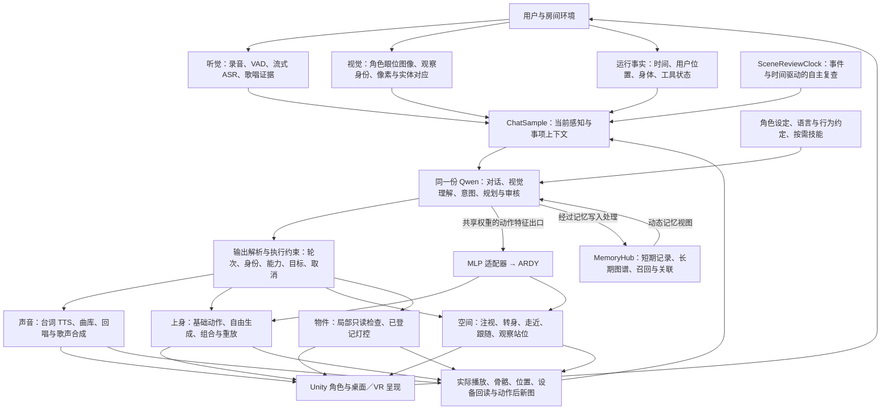

# NeEEvA 完整框架说明

梳理日期：2026-09-14。依据当前工作区源码、启动脚本及截至当日的实现与验证记录，包含尚未提交的工作区改动。本次为架构阅读与整理，没有启动模型服务、进入 Unity Play 或重新执行功能测试。“已接入”表示具有生产调用路径；实际成功范围以各模块记录为准。

## 1. 项目定位与整体闭环

NeEEvA 是运行在 Unity 三维空间中的 AI 虚拟角色交互系统：把实时听觉、角色自身视角、短期与长期记忆、事件调度、语言决策、声音表达、身体动作和场景操作接到同一个角色上。

当前框架可概括为：**感知 → 记忆与情境汇总 → 意图与行动决策 → 程序校验 → 声音／身体／场景执行 → 实际结果观察 → 继续决策。** 用户可以通过桌面或 VR 与这个闭环互动。

图中的“同一份 Qwen”指语言／视觉决策与动作特征共享模型权重。ASR、TTS、嵌入、歌声及 ARDY 仍有各自的专用模型和服务；整体并非单个神经网络端到端直接驱动所有输出。

## 2. 感知层：听见、看见、知道当前状态

### 2.1 实时听觉

- `RTSpeechHandler` 采集麦克风，处理 VAD、语音结束、打断与回声相关控制。
- SenseVoice 提供流式临时转写、完整录音终稿，以及情绪／音频事件等证据。
- 临时转写可触发内部预判、候选回答与预准备；正式执行仍需符合对应终稿和轮次条件。
- 混合说话／唱歌保留完整录音及片段证据。声学音高、旋律和分段文字帮助判断内容，不把所有人声都视为歌唱。
- 语音结束、录音身份、终稿版本和真实用户输入的关联用于拦截旧结果及误触发。

### 2.2 角色自身视角

当前主聊天链路使用 `NevaSceneVisionCapture`：从角色校准眼位与实际头朝向离屏渲染房间。图像携带 `captureId`、时间、场景、相机位姿和视场信息。

同一次预判、空间决定与正式回复关联对应的观察；过期、闭眼、换场景或视点改变后，旧图不能当成现在看见的内容。图像采集频率不等于模型推理频率。

**桌面内容的当前路径：Windows 桌面采集 → 房间电视纹理 → 角色实际视野 → Qwen。** 电视背面、遮挡、距离和字体像素会影响角色能看见或读清什么。README 中“直接把桌面截图送进主聊天”的说明属于旧路径。

### 2.3 像素与场景实体对应

模型选择当前图中的像素或已确认实体；Unity 通过图像、几何、可见性、实体身份与局部档案核验目标。视觉命名、场景作者标注、几何命中和已登记能力是不同来源的事实。

局部对象档案可以辅助辨认部件与可执行能力。当前已见实体快照主要在会话内保存，不能描述成已有完整、持久化的空间地图。

### 2.4 时间与运行状态

`SceneTime` 与 `SceneReviewClock` 记录活动时长、驻足、最近观察／动作／发言、暂停和未知时间间隔。动作结束、失败、环境动静和记忆浮现可以推动下一次复查。当前调度由场景复查时钟管理；`UrgeModel` 保留环境与记忆事件积累及兼容接口，不能只按旧的“冲动阈值＋疲劳倍数”概括现行调度。

## 3. 记忆与角色上下文

| 部分 | 当前作用 | 存续范围 |
| --- | --- | --- |
| 角色、语言、行为配置 | 身份设定、表达方式及行动约定 | 配置资产 |
| 对话历史 | 最近交流及相关反馈 | 受上下文管理约束 |
| 短期记忆 | 自动用户发言记录、角色主动 `note` | 会话内、随时间变化 |
| 长期图谱 | 事实节点、关联边、重要度、时间衰减 | `memory.json` 持久化 |
| 情境召回 | 名称提及、语义嵌入、关联扩散 | 运行时激活 |
| 联想与整理 | 安静时记忆浮现、关联补充、孤立节点整理入口 | 运行时过程，部分结果写入图谱 |
| 录音与歌曲记忆 | 会话素材身份与本地曲库 | 会话录音与持久曲库分别管理 |
| 空间观察记录 | 已见实体、时间和近期执行事实 | 主要为运行时快照 |

`MemoryHub.BuildMemoryMap()` 形成包含身份节点、当前唤起节点、关联边、短期记录和孤立节点的统一视图。它通过模型的 `TrailingContext` 动态提供，避免每轮把整份变化中的记忆图谱重复写进对话历史。可选嵌入服务增强召回，不等于没有嵌入便没有记忆。

记忆节点写入、更新和连边属于显式接口；程序还处理写入证据、名称解析和容量限制。不能从“有持久化记忆”推导出所有事实都能正确记住或永不遗忘。

## 4. 决策核心与自主循环

核心编排集中在 `ChatSample` 及其多个 partial 文件。它管理真实用户输入、感知事实、流式回答、动作、歌唱、工具反馈、事项状态和取消。

同一份 Qwen 在不同请求中承担：

1. 听觉临时理解与回答准备。
2. 正式对话和基于角色视野的视觉理解。
3. 无用户新输入时的私下观察、表达或行动意图判断。
4. 受约束的空间行动决策及必要的一次修正。
5. 特定路径上的目标进度、素材目标或台词事实审核。
6. 动作描述的实时语义特征提取。

角色可以说话、继续表达、保持安静、安排下一次复查、写记忆或选择已支持工具。自主观察不必伴随发声，安静也不代表循环停止。相同模型的审核属于额外判断，执行身份、合法参数和几何条件仍由程序独立控制。

`persona.txt`、`language.txt`、`behavior.txt` 提供基础上下文；歌唱技能按本轮意图或显式技能请求加载。技能加载状态、操作许可和已执行事实分别处理。仓库存在多个 LLM provider，但当前完整视觉／空间／共享动作特征链以 Qwen 为主，不能假设所有后端功能对等。

## 5. 执行层：声音、身体与物件

### 5.1 台词与语音

`RoleOutputChannels` 区分可听正文、内部文本、语言声明及执行通道。`SpeechText` 将语言元信息沿分句、缓存、队列送往 TTS。当前 GPT-SoVITS 已接入显式中／日／英语言声明，其他 TTS 实现具有不同兼容范围。

普通对话可流式分句合成播放。部分动作相关台词先缓冲，依据当前任务事实审核后放行。声音仲裁避免说话与歌唱同时抢占输出，用户打断、取消及旧异步回包受轮次检查。口型、字幕与实际输出衔接。

### 5.2 歌唱与歌曲素材

链路分为素材、目标、渲染和播放四部分：

- 素材：完整录音、会话 `clip` 身份、边界版本、音高／歌词证据及本地 `song` 曲库。
- 决策：选择有序素材、范围、音乐参数、来源确认、修订或存入曲库。
- 目标检查：录音 `clip` 的 `sing_goal` 路径具有独立目标审核、版本／顺序／范围核验及失败停止；这一套验收并未等量覆盖所有旧入口和曲库入口。
- 渲染：`9883` 独立 SVS 从歌词／旋律信息生成歌声；`9882` RVC／Seed-VC 执行歌声音色转换。两者意义不同，回退应保留来源事实。
- 播放：准备、提交、实际开始、播放完成、内容是否符合要求分别记录。

独立 SVS 后端为可选部署；日语假名到 SoulX 音素适配标为实验性。曲库条目可以只是学到的片段，不能把“记住一首歌”自动写成“能演唱该歌完整版本”。

### 5.3 上身动作

包含已注册的左右挥手、点头、摇头基础动作，以及自由描述生成、组合控制和最近完成轨迹的重放路径。实验性语义 `plan` 是单独入口，其开关与普通 `generate`／`compose` 不等价。

自由生成主链：

`动作意图 → ArdyLiveMotionController → ARDY HTTP → 共享 Qwen 动作特征 → MLP 适配器 → ARDY → Core27 轨迹 → Unity 骨骼重定向与播放`。

当前语义特征出口为 2048 维，使用与聊天共享的 Qwen 权重和独立短 context。适配器连接 Qwen 特征与 ARDY 的动作条件空间；离线教师模型用于训练／评估，不属于每次线上动作调用。

上身生成通道不会因此获得根移动和腿部行走控制。实际 VRM 骨骼观测可核验部分手腕区域、约束与执行结果，并支持有限修订；“达到区域”不能证明完整语义、手指细节或自然度。当前动作触发也不等于已经按 TTS 音节同步。

### 5.4 空间移动与注意

结构化房间决策由 `RoomTaskProtocol` 与 `ChatQW.RoomTask` 处理，经 `ArdyRoomDialogueBridge` 连接实际角色、用户锚点和房间。

当前接口包括：走近用户、持续跟随、停止移动、注视、调整视向、原地转身、接近物件，以及 `reposition-view` 观察站位调整。

Unity 负责地面、路径、支撑、净空、用户距离和目标有效性检查；ARDY 产生全身原生根运动与关节姿态；播放器管理实际控制权、连续性、到达、取消与回待机。行走占用身体时，上身动作不能同时抢写身体。

持续跟随采用短段连续生成，保留已采用动作历史、更新尚未执行的未来；来不及供给或候选异常时停止或恢复。它不是简单每次把角色 Transform 朝用户平移。

最新 `reposition-view` 可请求对同一可见目标前后左右调整站位并保持身体朝向，已经有原房间受控执行证据。小距离仍可能因步态候选异常被拒绝；成功移动和重新看见目标，并不直接证明读清文字或看全屏幕。

### 5.5 物件操作

当前支持局部实体只读检查，以及明确登记的灯具运行时开／关。必须符合当前视觉身份、能力登记、距离、角色／场景绑定与任务控制条件。

灯控实际修改受控材质发光与 Light 状态，再回读并采图；这是设备能力调用，没有完成角色伸手按实体开关的身体动作。烘焙照明残留也不属于该灯控接口可清除的范围。

## 6. 反馈、事项与自检

整个架构通过身份字段连接不同时间返回的结果：用户轮次、回复代次、录音与素材版本、动作 ID、图像 ID、实体 ID、任务与执行版本。其作用是让旧请求、旧图或被取消动作不能在新一轮重新生效。

反馈包括：真实发声／歌唱播放事实、实际骨骼观测、根位置与朝向、路径失败、目标重认、设备回读、工具结果和当前能力状态。

`WorkObservations`、`WorkProgress`、`SelfInspection` 等管理结果交付和会话内未完成事项。观察生成、结果送达模型、执行完成、用户目的完成分别处理。有限预算耗尽后保留未完成状态；不是跨重启任务数据库。

角色自检可以读取 motion／runtime 的已注册资源、绑定、队列和已知服务观察。它不是任意工程文件访问、Inspector 改写、Hierarchy 编辑或自修改代码接口。

## 7. 呈现层与部署

Unity 提供 VRM 角色、房间、Animator／ControlRig、口型、眨眼、眼神／头部跟随、尾部动态，以及声音与双语字幕。桌面有聊天／设置界面和悬浮字幕；VR 使用 OpenXR、空间字幕与控制器交互。目标 PICO 设备的舒适度、权限和设备差异仍需实机验收。

当前启动脚本声明的部署：

| 位置／服务 | 职责 | Unity 使用的端口 |
| --- | --- | --- |
| 5090：共享 Qwen + 视觉投影 + 动作特征 | 语言／视觉决策及动作特征 | 8080，经 SSH 转发 |
| 5090：bge-m3 | 记忆语义嵌入 | 8090，经 SSH 转发 |
| 4090：Unity | 房间、角色、交互、编排与执行 | — |
| 4090：ARDY + 适配器 | 手势与全身运动 | 8093 |
| 4090：SenseVoice | ASR、录音与歌唱分析 | 9881 |
| 4090：GPT-SoVITS | 台词语音合成 | 9880 |
| 4090：RVC／Seed-VC | 角色歌声音色转换 | 9882 |
| 4090：可选 SVS | 独立歌声合成 | 9883 |

`start_all.cmd` 依次准备共享 Qwen 特征模式及嵌入、ARDY、语音相关服务。上表是开发部署结构，不是面向最终用户的最低硬件要求；本次未探测这些服务是否正在运行。

## 8. 当前能力与未完成部分

| 分类 | 当前状态 |
| --- | --- |
| 实时语音、语言声明、打断、长期图谱与召回 | 已接入；质量和延迟依赖具体场景 |
| 自身视角、物件定位、注视、走近、转身、灯控 | 已接入，并有分项真实运行证据 |
| 连续跟随与观察站位调整 | 已接入，有受控房间验证；异常步态仍可能拒绝 |
| 自由生成与动作修订 | 已接入，完整语义和动作自然度仍有局限 |
| 实验性语义规划、日语独立 SVS 适配 | 实验／受开关与部署限制 |
| 完整跨会话空间经历地图 | 尚未完成；现有文本记忆不能等同替代 |
| 上下台阶、跨楼层、坐下起身、抓取放回、完整手指控制 | 尚无完整执行与验收闭环 |
| 任意场景编辑或自修改工程 | 未开放通用接口 |
| 面向公众的端到端稳定性与延迟 | 需要整套现场流程验证，局部测试不代表全链路验收 |

特别注意文档时间顺序：9 月 14 日较早的阶段评估写“观察站位调整尚未接入”；当日后续实现已增加 `reposition-view`。同样，旧 README 的 Top-N 记忆概括和直接桌面视觉也不能完整代表当前源码。

## 9. 用一次交互理解框架

以“看着电视，后退半米，试着把整块屏幕看进来”为例，设计调用顺序为：

1. ASR 提供本次录音对应的完整话语。
2. 角色自己的相机提供当前房间图，而非用户相机画面。
3. 记忆与最近对象事实帮助理解所指电视；当前图和几何核验其实体。
4. Qwen 选择 `reposition-view`，声明距离、方向和观察目的。
5. Unity 核验同层支撑、身后空间、路径与身体控制权。
6. 共享 Qwen 提供动作条件，适配器与 ARDY 生成保持朝向的后退轨迹。
7. Unity 检查并播放真实全身运动，记录实际位移与终态。
8. 角色从新的位置重新采图、核验同一实体，并判断观察目的是否满足。
9. 角色根据这些事实回应；可说已经后退，但是否看全仍需新图依据。

这是代码所支持的链路说明，不是本次新执行的一次演示。

## 10. 对外介绍建议

适合投资人资料的一句话：

> **NeEEvA 将感知、记忆、决策、声音与身体行动连接在同一个虚拟角色上，探索能够在三维空间中持续相处的 AI 角色体验。**

传单可使用“感知—记忆—决策—行动—反馈”五段概览；完整架构与实测边界适合放在扫码资料或路演备份页。现有成果重点是第三方模型之上的角色编排、共享语义特征接入、身体与场景执行，以及带身份和实际结果的反馈机制。商业化路径、用户数据和融资诉求应另外以团队真实资料填写。

## 11. 主要依据

- [主编排源码](../Assets/AIChatTookit/Scripts/Chat/ChatSample.cs)
- [当前记忆实现](../Assets/AIChatTookit/Scripts/Memory/MemoryHub.cs)
- [当前场景视觉接入](../Assets/AIChatTookit/Scripts/Chat/ChatSample.SceneVision.cs)
- [场景时间与调度](../Assets/AIChatTookit/Scripts/Chat/ChatSample.SceneTime.cs)
- [当前房间协议](../Assets/AIChatTookit/Scripts/Chat/RoomTaskProtocol.cs)
- [角色场景视觉](scene-vision-20260913.md)
- [物件身份与能力](scene-object-awareness-20260913.md)
- [观察站位调整与回复延迟](scene-view-position-and-response-latency-20260914.md)
- [连续跟随](ardy-continuous-follow-20260912.md)
- [实时动作协议](ardy-live-protocol.md)
- [动作反馈与修订](ardy-motion-feedback.md)
- [适配器训练与接入](../Tools/MotionAdapter/README.md)
- [事项与歌唱执行闭环](agent-work-loop.md)
- [统一歌唱素材协议](singing-material-protocol.md)
- [独立歌声渲染](../Server/SVS/README.md)
- [台词语言协议](speech-language-protocol.md)
- [桌面与 VR 界面](companion-interface.md)
- [主启动入口](../start_all.cmd)

