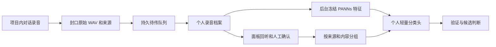

# 项目内的个人声音学习

NeEEvA 增加可选的「声音学习」页，使用现有桌面／VR 控制面板和录音链路。用户不需要导出 WAV、在外部网页标注，或手动制作训练／验证清单。启用后，实际交互录音成为待确认材料；明确确认的音频区间在后台用于训练个人小分类头。

这是采集、人工确认、分组、训练、候选检查的第一版。个人头尚不控制角色的正式裁切／回唱。上一阶段仍有漏掉歌头和歌曲中途断开的问题，不能把声学分类分数直接当成完整表演的裁切范围，也不能把这次软件接入当作精度已提升的证明。

## 使用

1. 启动项目内声音学习服务。当前开发机可运行 `Tools/SingingSegmentation/start-personal-learning.ps1`，使用已有 Python、PANNs 权重和隔离依赖，无下载或安装。默认地址 `http://127.0.0.1:9884`；面板可配置另一个服务地址。
2. 运行 Unity，在现有交互控制面板打开「声音学习」，连接并选择／新建自己的用户档案。
3. 填写歌曲／练习名称，创建一轮采集并开启采集。名字可以用中文。同一首歌的重唱沿用同名；换另一首歌时创建另一轮。程序在录音开始时冻结当前档案与会话。
4. 继续使用按住说话或实时交互。录音结束后会进入列表；预识别、心里话、LLM 对歌唱意图的判断均不会生成训练标签。
5. 选择录音，按需回听原音，指定起止区间，加入「说话／唱歌／环境音／不确定」。独立确认声源属于本人、外放、混合或未知，随后保存。未标区域不会自动当作说话；不确定区间和非本人声源不参与个人头训练。
6. 保存会触发后台合并训练。面板显示素材是否足够、任务进度与候选结果；也可以手动重试特征提取、训练和查看候选判断。

默认采集关闭。关闭采集或切换档案会取消尚未封口的采集票据；已经封口的待传录音保持原来的档案、会话和服务地址，不能重新归到当前用户。待传队列持久保存到 Unity 的 `Application.persistentDataPath/PersonalSingingLearning/outbox`，服务原音与标签默认保存在 `Server/SingingLearning/data`。队列上限会明确暂停新采集；不会悄悄覆盖旧录音。

## 分组与确认

原始 WAV 的 SHA256、采样率、声道数和实际采样长度由服务重新计算。所有标注采用原音的整数采样区间，与对应录音及标签修订绑定；过期修订提交返回冲突，需要重新读取。原音不被标注、预测或训练改写。

同会话、同歌曲／练习、相同 WAV、同父来源及录音器报告的共享 PCM 来源全部形成连通组。同组始终只进入训练或验证的一边，不随机拆帧。至少需要 3 个独立组，其中训练至少 2 组、验证至少 1 组，且两边都存在已确认的歌唱与非歌唱。条件不足会返回明确缺项，不按标签重新排列分组来制造通过。

这属于随数据变化重新划分的开发验证，不是冻结盲测，也不能证明新歌曲、新设备或新用户的泛化。重复来源同组，但首版不把组内所有重叠采样按物理来源再去重；报告明确此限制。用户档案由人显式选择，不依赖歌声可能改变的临时声纹 ID。

外放的歌声仍属于声学歌唱，不能为了防回声而标成「说话」。声源归属与声学类别分开；歌中正常换气是否保留，还需要下一阶段的表演连续性判断。

## 执行链路

封口 hook 覆盖实时硬结束、预识别结果复用结束、按住说话及旧按钮录音；均在歌唱／ASR 接受过滤之前。短噪音录音可成为待复核材料，无法证明实际捕获长度的缓冲区不冒充原始录音。专用 PCM16 编码器完整保留多声道采样，避免旧转换器少写立体声采样的问题。

服务位于 `Server/SingingLearning`，独立于正式 SenseVoice 进程，HTTP 只提交任务，单后台 worker 串行提取特征和拟合。默认 CPU、2 个计算线程，首次使用时加载 PANNs；不会占用现有 ASR 模型锁或在回复链路等待训练结果。CPU、内存与上传仍有实际开销，这不是端到端延迟改善的承诺。

特征和拟合复用前一阶段的冻结 PANNs 与 9 维 L2 logistic 小头。仅训练数据用于标准化，阈值固定 0.5，无自动补洞或片段拼接。每个版本保留来源修订、分组、特征身份、权重与验证预测；所有输出均为未校准的候选分数，并保持 `execution_authorized=false`。

## 部署范围

本轮交付独立服务与 Unity 客户端。Windows 启动脚本使用当前已验证的开发资产位置，也接受显式 Python／权重／标签／依赖／数据目录参数。换电脑或迁到 DGX Spark 时，仍需准备该平台的 Python 声学运行环境和固定版本权重；无需用户预制个人录音数据。已有的 ASR、TTS、LLM 服务没有被重启或替换。

这是声音类别学习，不是 ASR 文字模型微调，也不是角色知识或语言能力训练。接下来的上线条件仍是：用项目内新样本验证个人适配收益，补齐连续歌句与精细边界，再决定怎样让个人头进入正式回唱。

接口与持久数据约定见 [API.md](../Server/SingingLearning/API.md)。

## 本轮验证记录

- 服务 18 项回归通过，包含真实 localhost HTTP、原音返回、标注版本冲突、异步队列，以及合成冻结特征配合真实 NumPy 拟合；这部分不作为声音识别准确率成绩。
- 录音器 32 项独立回归通过：直接编译当前生产源码，覆盖完整立体声 PCM、只封口一次、短噪音保留、关闭采集与异常隔离、旧按钮录音的实际采样长度。
- 使用已确认的 c9 原音做独立临时 HTTP 服务实测，上传／下载逐字节一致，原始 SHA256、16000 Hz 和 305120 个采样均正确；人工修订成功，重复提交旧版本返回 409；只有一组材料时正确报告不足，不生成伪验证模型。
- 本机 CPU 双线程处理 c9 的 19.07 秒声音：PANNs 推理 1.503 秒，含解码分析 1.539 秒。首次后台任务包含导入、哈希和模型加载，共 28.753 秒，其中模型构造／加载 14.502 秒。原音上传应答 0.056 秒，后台处理期间健康查询中位数 0.0029 秒。这些是独立学习服务测量，不是 Unity 对话首音测量。
- Unity 内另执行 35 项客户端／协议检查，覆盖真正的会话切换、迟到回听取消、停用后待传恢复和后台保存元数据隔离。桌面／VR 各检查顶部、标注区、底部，共 6 张实际渲染图；预览不创建学习客户端，不开麦或播放。渲染检查发现并修正页签／按钮文字截断与短结果末尾留白。

实测原始证据：[真实 HTTP 与 PANNs 结果](../work/personal-singing-learning-20260929/real-http-20260929-135251/result.json)、[独立审计](../work/personal-singing-learning-20260929/capture-and-label-audit.md)。

本轮已在本机启动可选 `9884` 服务，使用空的个人档案存储，等待用户在项目面板主动开启采集。服务不是系统自启动；重启机器后重新运行上述启动脚本即可。没有自动迁移到 DGX Spark。
